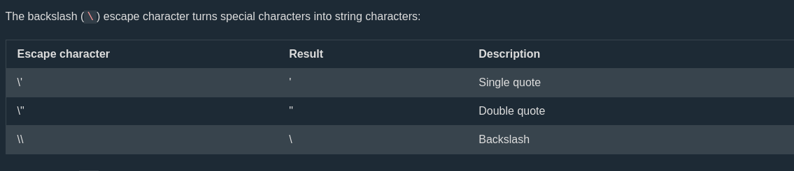
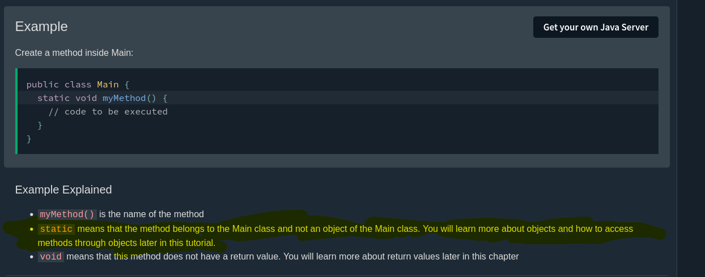

# Notes

## Strings

Reference :  https://www.w3schools.com/java/java_stringbuilder.asp



----


a String cannot be changed after it is created. When you add text to a string, Java does not change the old string. It creates a new string every time.

A StringBuilder is a string that can be changed. You can add, insert, replace, delete and reverse text, and Java keeps changing the same text. Think of it like a document that you keep editing, instead of writing a new copy for  every change.

```
StringBuilder sb = new StringBuilder("Hello");
sb.append(" World");
System.out.println(sb);
```

---

## Math Class

```
Math.min(5, 10);
Math.max(5, 10);
Math.sqrt(64);

Math.abs(-4.7); // 4.7


Math.pow(2, 8);  // 256.0
Math.round(4.6);  // 5
Math.ceil(4.1);   // 5.0
Math.floor(4.9);  // 4.0
```

---


## Short Hand if...else
https://www.w3schools.com/java/java_conditions_shorthand.asp

```
int time = 20;
String result = (time < 18) ? "Good day." : "Good evening.";
```
---

### Nested Ternary

```
int time = 22;
String message = (time < 12) ? "Good morning."
               : (time < 18) ? "Good afternoon."
               : "Good evening.";
System.out.println(message);

```
---

## Switch

```
switch(expression) {
  case x:
    // code block
    break;
  case y:
    // code block
    break;
  default:
    // code block
}
```
---
## The for-each Loop

```
for (type variableName : arrayName) {
  // code block to be executed
}
```

```
String[] cars = {"Volvo", "BMW", "Ford", "Mazda"};

for (String car : cars) {
  System.out.println(car);
}

```

---

## Array

https://www.w3schools.com/java/java_arrays.asp

```
String[] cars = {"Volvo", "BMW", "Ford", "Mazda"};
```


--

You can also create an array by specifying its size with new. This makes an empty array with space for a fixed number of elements, which you can fill later:

```
String[] cars = new String[4]; // size is 4

cars[0] = "Volvo";
cars[1] = "BMW";
cars[2] = "Ford";
cars[3] = "Mazda";

System.out.println(cars[0]); // Outputs Volvo
```
Examples:
```

        StringBuilder s[] = {
        new StringBuilder("hello") , 
        new StringBuilder("i") , 
        new StringBuilder("am"), 
        new StringBuilder("Sam")};

        for(StringBuilder element : s){
            System.out.println(element);
        }

        for (var element : s){
            System.out.println(element);
        }

        for(int i = 0 ; i < s.length ; i++){
            System.out.println(s[i]);
        }
```
---

## Static Key Word


https://www.w3schools.com/java/java_methods.asp

It's basically like creating a Global variable outside a function in C or python to keep counting.

---


